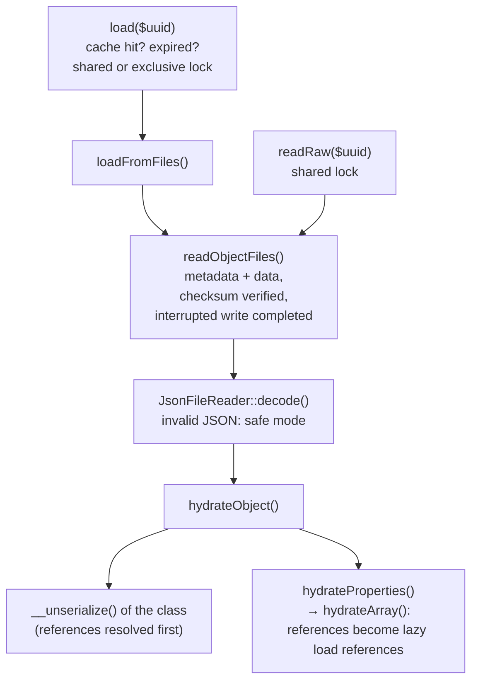

# Internals

How `ObjectStorage` loads and stores objects, for developers working on the library. Users of the library need [Getting started](getting-started.md) and [Concepts](concepts.md) instead.

## Files of an object

Every object is two files in the shard directory of its UUID (`shards/<a>/<b>/…`, see `buildShardedDirectory()`):

| File | Contents |
|---|---|
| `<uuid>.obj` | the data: the serialized object graph as JSON, references to other objects as `{"__reference": "<uuid>"}` |
| `<uuid>.metadata` | the metadata: class, checksum of the data and its algorithm, revision, created (`timestampCreation`), modified (`timestampModification`: the last write of the data or `touch()`), expiration, UUID |

The two files are written together as a group (`writeObjectFiles()`), so a crash can't leave data without matching metadata; `recoverInterruptedWrite()` completes or discards an interrupted group. Besides them, a stub per object in `stubs/<md5 of the class>/` lists the objects of a class (`createStub()`), and `stubs/classnames.json` the classes.

## Verbs

`ObjectStorage` is grouped in sections (creating, paths, storing, loading, files, metadata, lifetime, deleting, listing, stubs, cache). Each verb has one meaning:

| Verb | Level | Examples |
|---|---|---|
| `load` / `store` / `delete` | objects, with caches, locks and events — the public API | `load()`, `store()`, `delete()`, `loadMetadata()` |
| `readRaw` / `writeRaw` | objects as stored, unchanged (`Transfer\RawAccessTrait`) | copying into another storage |
| `read…` / `write…` | files, without caches | `readObjectFiles()`, `writeObjectFiles()`, `writeMetadata()`; JSON files through `File\JsonFileReader` and `File\JsonFileWriter` (`getJsonFileReader()`, `getJsonFileWriter()`) |
| `hydrate…` | stored data → object | `hydrateObject()`, `hydrateProperties()`, `hydrateArray()` |
| `serialize…` | object → stored data | `serializeGraph()` |

`loadMetadata()` reads metadata through the metadata cache, `reloadMetadata()` from the file (the cache may be outdated when another process changed the object).

## Loading



- `readObjectFiles()` is the one place that reads the files of an object; `load()` and `readRaw()` share it. A checksum mismatch enables safe mode when loading, not when reading raw (copying many objects goes on).
- References aren't loaded with the object: they become `LazyLoadReference`s, loaded when used.

## Storing

```mermaid
flowchart TD
    store["store($object)"] --> storeObject["storeObject()<br/>one object of the graph"]
    storeObject --> graph["serializeGraph()<br/>properties → data"]
    graph -->|"referenced objects,<br/>child persistence policy"| storeObject
    storeObject --> lock["exclusive lock<br/>(after the referenced objects)<br/>revision + optimistic locking"]
    lock --> files["writeObjectFiles()<br/>data + metadata as a group"]
    lock --> meta["writeMetadata()<br/>only the metadata changed"]
    files --> stub["createStub(), cache, events"]
    writeRaw["writeRaw($rawObject)<br/>exclusive lock"] --> files
```

- `storeObject()` is called once per object of the graph; referenced objects are stored first, so an object never refers to one that isn't stored. Its lock is taken only then, so no more than two locks are held at once.
- The data file is only written if the data changed (checksum); otherwise only the metadata, e.g. a new lifetime.
- Before the data is written, `checkConstraints()` (`Constraint\ConstraintsTrait`) asks every registered constraint, e.g. a unique index, with the data as it will be stored; a violation stops the write. The callback it returns runs after the write, successful or not, so a constraint can keep or release what it reserved. `writeRaw()` does the same; code writing object files itself (like the viewer when editing a record) has to call it as well.

## Deleting

`delete()` → `deleteObject()` per object: the files and the stub are removed under the lock of the object; `findChildrenToDelete()` decides by the child deletion policy which referenced objects follow (`delete($uuid, applyChildDeletionPolicy: false)` deletes only the object itself).

## JSON files

`File\JsonFileReader` and `File\JsonFileWriter` read and write all JSON files of the storage — metadata, the registry of class names — and the assignments of configurations:

- The reader reports a file it can't read (logged, `IO_READ_FAILURE`) and returns `null`; invalid JSON is reported (`JSON_DECODING_FAILURE`) and throws a `SerializationFailureException`. `tryDecode()` only looks into JSON, e.g. for references, without reporting a damaged file.
- What a damaged file means is the caller's decision: the storage passes `onCorruption`, which enables safe mode (`getJsonFileReader()`); `readRaw()` and deleting don't.
- The writer encodes with the maximum depth of the strategy and writes atomically with the writer of the storage, so readers see the previous or the new contents.
- `getJsonFileReader()` and `getJsonFileWriter()` create them per use, so a reader, writer or strategy set later is used.

## Retained locks

A [transaction](transactions.md) keeps every object it changed locked from the first change to the commit or rollback. It records an object while it is written: `writeObjectFiles()`, `writeMetadata()` and `deleteObject()` call `Transaction::track()` of the active transaction of the instance, under the exclusive lock the writing code took, before anything changes. So a transaction *retains* its locks (`Locking\RetainedLocksTrait`, part of `ObjectStorage`): `retainLock($uuid)` takes the exclusive lock (or marks the one held), `releaseRetainedLock($uuid)` removes the mark and releases the lock, and every release of an object lock asks `isLockRetained()` first — `store()`, `deleteObject()` and `setLifetime()`, which release a lock they didn't take (for `store()` on purpose: an exclusive load holds the lock until the object is stored, see [Concurrency](concurrency.md)), and the code releasing only what it locked (`$lockedHere`: `storeObject()`, `touch()`, `writeRaw()`, OQL writes, moving objects), whose lock may have become retained meanwhile.

Why only this, and no general helpers:

- **The lock adapter stays the only way to lock** (`acquireExclusiveLock()`, `acquireSharedLock()`, `releaseLock()`). Helpers such as `withObjectLock()` would add a second way to do the same.
- **Locks of resources** (the class name registry, index and unique managers, stepped maintenance, configurations, the lock of a transaction itself) don't belong to objects; retaining doesn't apply to them.
- **Reentrant locks** (counting acquire and release in the adapter) would make retaining unnecessary, but they change the behavior of the public `LockAdapterInterface`, and exclusive loads, which hand their lock over to `store()`, would need a rule of their own. That is more risk for the same result while transactions are the only code holding locks across operations. Reconsider it when more code needs to.

Retaining is bookkeeping of the storage instance; the lock is an ordinary lock of the adapter, which other processes wait for as usual.

## Journal

`Journal\Journal` is an append-only log in a directory of its own, used by [transactions](transactions.md) and meant for other logs that must survive crashes:

```php
use melia\ObjectStorage\Journal\Journal;

$journal = new Journal($directory, $storage->getIOAdapter(), sync: true);
$sequence = $journal->append('order-placed', ['uuid' => $uuid]);   // 1, 2, 3, … without gaps

foreach ($journal->read(afterSequence: $lastProcessed) as $entry) {
    // $entry->sequence, $entry->type, $entry->payload (JSON types), $entry->time
}

$journal->prune($lastProcessed); // removes the segments holding only entries up to it
$journal->remove();              // removes the journal
```

- **Format:** segment files named after the sequence number of their first entry (`00000000000000000001.journal`), one entry per line: the CRC32 of the JSON, a space, the JSON. A new segment is started when one would grow beyond the segment size (16 MiB by default).
- **Crashes:** an interrupted append can only damage the end of the last segment; it is ignored when reading and cut off by the next append. A damaged entry followed by intact ones, or a gap in the sequence, throws a `CorruptedJournalException`.
- **fsync:** with `sync` (the default), every append is flushed to disk before `append()` returns.
- **Concurrency:** appends of several processes on one host are serialized by `flock` on `journal.lock`. File locks aren't reliable on network file systems; there, appends of several hosts need a lock of their own.
- All file access goes through the IO adapter (`File\IO\AdapterInterface`), so tests can inject failures.

## Where to change what

| To change … | look at |
|---|---|
| how properties are written | `serializeGraph()`, `transformValueForGraph()`, the strategy (`Strategy\Standard`) |
| how properties are restored | `hydrateProperties()`, `hydrateArray()`, `resolveReferences()` |
| checksums, crash recovery | `readObjectFiles()`, `findMatchingMetadata()`, `recoverInterruptedWrite()`, `File\Writer` |
| what the metadata holds | `Metadata\Metadata`, `writeMetadata()`, `loadMetadata()` |
| locking | `load()`, `storeObject()`, `deleteObject()`, `Locking\LockAdapterInterface`, `Locking\RetainedLocksTrait` |
