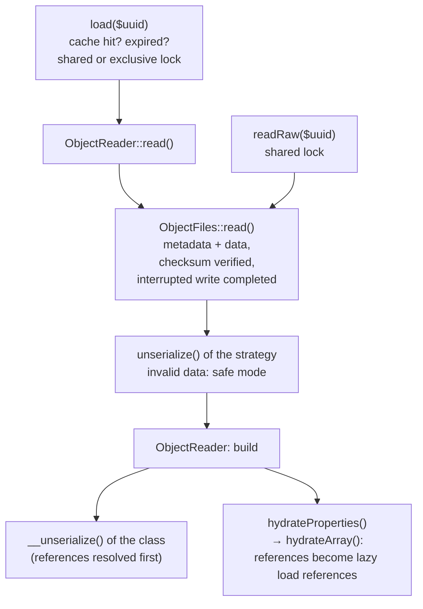

# Internals

How `ObjectStorage` loads and stores objects, for developers working on the library. Users of the library need [Getting started](getting-started.md) and [Concepts](concepts.md) instead. How the storage is split into components, and the rules for them: [Architecture](architecture.md).

## Files of an object

Every object is two files in the shard directory of its UUID (`shards/<a>/<b>/…`, see `ObjectPaths::shardedDirectory()`):

| File | Contents |
|---|---|
| `<uuid>.obj` | the data: the serialized object graph as JSON, references to other objects as `{"__reference": "<uuid>"}` |
| `<uuid>.metadata` | the metadata: class, checksum of the data and its algorithm, revision, created (`timestampCreation`), modified (`timestampModification`: the last write of the data or `touch()`), expiration, UUID |

The two files are written together as a group (`ObjectFiles::write()`), so a crash can't leave data without matching metadata; `ObjectFiles::recover()` completes or discards an interrupted group. Besides them, a stub per object in `stubs/<md5 of the class>/` lists the objects of a class (`StubIndex`), and `stubs/classnames.json` the classes (`ClassNameRegistry`).

## Verbs

`ObjectStorage` is the facade: it holds the construction, the configuration and the state of the instance, and delegates to components (`Storage\ObjectReader`, `ObjectWriter`, `ObjectDeleter`, `ObjectFiles`, `MetadataStore`, …, see [Architecture](architecture.md)). Its public methods are grouped by concern in traits (`Storage\*Trait`, `UUID\IdentityTrait`, `Transfer\RawAccessTrait`, `Locking\RetainedLocksTrait`, `Constraint\ConstraintsTrait`), which create the components. Each verb has one meaning:

| Verb | Level | Examples |
|---|---|---|
| `load` / `store` / `delete` | objects, with caches, locks and events — the public API | `load()`, `store()`, `delete()`, `loadMetadata()` |
| `readRaw` / `writeRaw` | objects as stored, unchanged (`Transfer\RawAccessTrait`) | copying into another storage |
| `read…` / `write…` | files, without caches | `ObjectFiles::read()`/`write()`, `MetadataStore::write()`, `JsonStore`; see [Files](#files) |
| `hydrate…` | stored data → object | `ObjectReader` |
| `serialize…` | object → stored data | `ObjectWriter` |

`loadMetadata()` reads metadata through the metadata cache, `reloadMetadata()` from the file (the cache may be outdated when another process changed the object).

## Loading



- `ObjectFiles::read()` is the one place that reads the files of an object; `load()` and `readRaw()` share it. A checksum mismatch enables safe mode when loading, not when reading raw (copying many objects goes on).
- References aren't loaded with the object: they become `LazyLoadReference`s, loaded when used.

## Storing

```mermaid
flowchart TD
    store["store($object)"] --> storeObject["ObjectWriter::write()<br/>one object of the graph"]
    storeObject --> graph["serializeGraph()<br/>properties → data"]
    graph -->|"referenced objects,<br/>child persistence policy"| storeObject
    storeObject --> lock["exclusive lock<br/>(after the referenced objects)<br/>revision + optimistic locking"]
    lock --> files["ObjectFiles::write()<br/>data + metadata as a group"]
    lock --> meta["MetadataStore::write()<br/>only the metadata changed"]
    files --> stub["StubIndex::add(), cache, events"]
    writeRaw["writeRaw($rawObject)<br/>exclusive lock"] --> files
```

- `ObjectWriter::write()` is called once per object of the graph; referenced objects are stored first, so an object never refers to one that isn't stored. Its lock is taken only then, so no more than two locks are held at once.
- The data file is only written if the data changed (checksum); otherwise only the metadata, e.g. a new lifetime.
- Before the data is written, `Constraint\ConstraintChecker` (`checkConstraints()` of the facade) asks every registered constraint, e.g. a unique index, with the data as it will be stored; a violation stops the write. The callback it returns runs after the write, successful or not, so a constraint can keep or release what it reserved. `writeRaw()` does the same (the viewer saves edited records with it); code writing object files itself has to call it as well.

## Deleting

`delete()` → `ObjectDeleter`, per object: the files and the stub are removed under the lock of the object; the child deletion policy decides by the child deletion policy which referenced objects follow (`delete($uuid, applyChildDeletionPolicy: false)` deletes only the object itself).

## Files

The storage reads and writes its files in layers, each with `read()` and `write()`:

| Layer | Reads and writes | Errors |
|---|---|---|
| `File\IO\AdapterInterface` | the file system (the real one, or one injected by tests) | |
| `File\FilesInterface` (`File\Files`, `getFiles()`/`setFiles()`) | bytes: `read()` (`null` if there is no file), `write()` atomically (staging file, rename), `writeGroup()` several files so that after a crash all or none hold the new contents, `recover()` completes an interrupted group; flushed to disk unless `setSyncEnabled(false)` | `IOException` |
| `File\JsonFiles` (with `File\Json`) | JSON: `read()` decodes, `write()` encodes, with a maximum depth, errors thrown | `CorruptedFileException` for invalid JSON, `SerializationFailureException` for values JSON can't hold |
| `readJson()`, `writeJson()` of the storage (`Storage\JsonTrait`) | its JSON files: metadata, the registry of class names | reports a file it can't read (logged, `IO_READ_FAILURE`); invalid JSON is a damaged file: `JSON_DECODING_FAILURE`, safe mode |
| `Storage\ObjectFiles` (`readObjectFiles()`, `writeObjectFiles()` of the facade) | an object: its data and metadata as a group, the checksum verified, an interrupted write completed | `ChecksumMismatchException`, `InvalidFileFormatException`, safe mode |

- The data of an object is encoded and decoded by the strategy (`serialize()`, `unserialize()`); the checksum is computed over its bytes, so it is read as bytes (`getFiles()->read()`). Data that only is looked into, e.g. for references while deleting or copying, is decoded without taking invalid data as a damaged storage.
- `JsonFiles` is created per use with the files and the maximum depth of the strategy, so files or a strategy set later are used. Configurations (`Configuration\Registry`) use it on their own.

## Retained locks

A [transaction](transactions.md) keeps every object it changed locked from the first change to the commit or rollback. It records an object while it is written: `ObjectWriter`, `ObjectDeleter`, `writeObjectFiles()` and `writeMetadata()` call `Transaction::track()` of the active transaction of the instance (passed to the components with each call), under the exclusive lock the writing code took, before anything changes. So a transaction *retains* its locks (`Locking\RetainedLocksTrait`, part of `ObjectStorage`): `objectLocks()->retain($uuid)` takes the exclusive lock (or marks the one held), `objectLocks()->releaseRetained($uuid)` removes the mark and releases the lock, and every release of an object lock asks whether it is retained first (`Locking\ObjectLocks`) — `store()`, `ObjectDeleter` and `setLifetime()`, which release a lock they didn't take (for `store()` on purpose: an exclusive load holds the lock until the object is stored, see [Concurrency](concurrency.md)), and the code releasing only what it locked (`ObjectLocks::exclusively()`: `ObjectWriter`, `touch()`, `writeRaw()`, OQL writes, moving objects), whose lock may have become retained meanwhile.

Why only this, and no general helpers:

- **The lock adapter stays the only way to lock** (`acquireExclusiveLock()`, `acquireSharedLock()`, `releaseLock()`). Helpers such as `withObjectLock()` would add a second way to do the same.
- **Locks of resources** (the class name registry, index and unique managers, stepped maintenance, configurations, the lock of a transaction itself) don't belong to objects; retaining doesn't apply to them.
- **Reentrant locks** (counting acquire and release in the adapter) would make retaining unnecessary, but they change the behavior of the public `LockAdapterInterface`, and exclusive loads, which hand their lock over to `store()`, would need a rule of their own. That is more risk for the same result while transactions are the only code holding locks across operations. Reconsider it when more code needs to.

Retaining is bookkeeping of the storage instance; the lock is an ordinary lock of the adapter, which other processes wait for as usual.

## Journal

`Journal\Journal` is an append-only log in a directory of its own, used by [transactions](transactions.md) and meant for other logs that must survive crashes:

```php
use melia\ObjectStorage\Journal\Journal;

$journal = new Journal($directory, $storage->getIOAdapter(), sync: true);
$sequence = $journal->append('order-placed', ['uuid' => $uuid]);   // 1, 2, 3, … without gaps

foreach ($journal->read(afterSequence: $lastProcessed) as $entry) {
    // $entry->sequence, $entry->type, $entry->payload (JSON types), $entry->time
}

$journal->prune($lastProcessed); // removes the segments holding only entries up to it
$journal->remove();              // removes the journal
```

- **Format:** segment files named after the sequence number of their first entry (`00000000000000000001.journal`), one entry per line: the CRC32 of the JSON, a space, the JSON. A new segment is started when one would grow beyond the segment size (16 MiB by default).
- **Crashes:** an interrupted append can only damage the end of the last segment; it is ignored when reading and cut off by the next append. A damaged entry followed by intact ones, or a gap in the sequence, throws a `CorruptedJournalException`.
- **fsync:** with `sync` (the default), every append is flushed to disk before `append()` returns.
- **Concurrency:** appends of several processes on one host are serialized by `flock` on `journal.lock`. File locks aren't reliable on network file systems; there, appends of several hosts need a lock of their own.
- All file access goes through the IO adapter (`File\IO\AdapterInterface`), so tests can inject failures.

## Where to change what

| To change … | look at |
|---|---|
| how properties are written | `Storage\ObjectWriter`, the strategy (`Strategy\Standard`) |
| how properties are restored | `Storage\ObjectReader` |
| checksums, crash recovery | `Storage\ObjectFiles`, `File\Writer` |
| what the metadata holds | `Metadata\Metadata`, `Storage\MetadataStore` |
| locking | `load()`, `store()`, `Locking\ObjectLocks`, `Locking\LockAdapterInterface`, `Locking\RetainedLocksTrait` |
